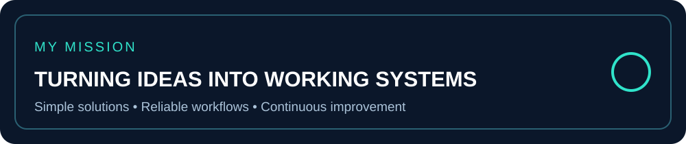
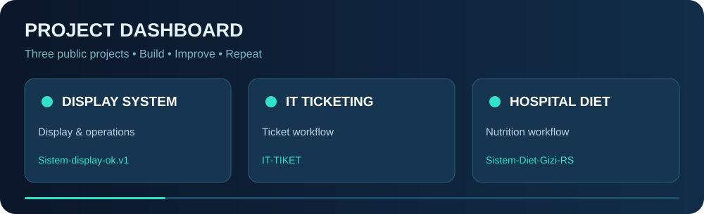

### 👋 About me

I enjoy building practical applications and improving everyday workflows through technology. My GitHub is where I organize projects, test ideas, and keep learning.

### 🚀 Featured projects

| Project | Description |
| --- | --- |
| [Sistem Display OK](https://github.com/atnanbuyung00-prog/Sistem-display-ok.v1) | Display and workflow system |
| [IT-TIKET](https://github.com/atnanbuyung00-prog/IT-TIKET) | IT ticketing project |
| [Sistem Diet Gizi RS](https://github.com/atnanbuyung00-prog/Sistem-Diet-Gizi-RS) | Nutrition and hospital diet system |

### 📊 Projects &amp; contributions

**Thanks for visiting!** ✨

